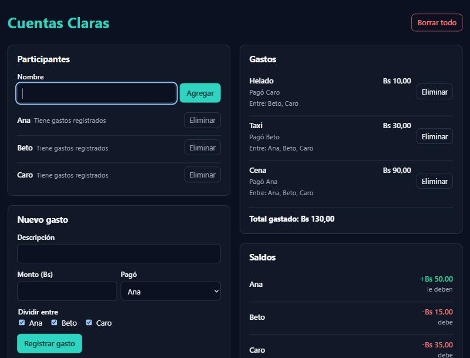

# Cuentas Claras

App web para dividir gastos compartidos entre amigos: un viaje, una cena o un
departamento compartido. Hecha con React y TypeScript siguiendo
**Spec-Driven Development (SDD)**. Corre solo en el navegador: sin backend, sin
llamadas de red y sin deploy.

Se agregan los participantes, se registra cada gasto (quién lo pagó y entre
quiénes se divide) y la app muestra:

- el **saldo** de cada persona (cuánto le deben o cuánto debe),
- la **liquidación sugerida**: una lista corta de transferencias del tipo
  "Caro paga Bs 35,00 a Ana" para que todos queden a mano.

Los montos se manejan en centavos enteros (nada de `0.1 + 0.2`), el reparto
desigual de centavos es determinista (Bs 10,00 entre tres = 3,34 / 3,33 / 3,33)
y los datos se guardan en el navegador. La interfaz está en español.



## Cómo correrla

Requiere Node.js 20.19 o superior.

```bash
npm install
npm run dev
```

Abre la dirección que muestra Vite (normalmente `http://localhost:5173`).

| Comando | Para qué |
|---|---|
| `npm test` | Pruebas con Vitest (143 pruebas) |
| `npm run typecheck` | Chequeo de tipos (`tsc --noEmit`) |
| `npm run lint` | ESLint |
| `npm run build` | Build de producción en `dist/` |
| `npx vite preview` | Sirve la build (no abre con doble clic en `index.html`) |

Una tarea está "verde" cuando pasan las pruebas, los tipos, el lint y la build.

## Estructura de la especificación

```
CLAUDE.md                     constitución: reglas que valen para todo el proyecto
specs/cuentas-claras/
  spec.md                     QUÉ hace la app: modelo, historias HU-1 a HU-4 y
                              requisitos RQ-01 a RQ-12 con criterios de aceptación
  plan.md                     CÓMO se construye: stack, arquitectura, decisiones
                              y qué prueba cubre cada RQ
  tasks.md                    tareas T-01 a T-10, cada una con los RQ que cubre,
                              sus pruebas y cuándo está hecha
  verification.md             cada uno de los 52 criterios con su estado y evidencia
```

El código está en `src/`, en tres capas, con las pruebas junto a cada archivo:

```
src/
  domain/       funciones puras: dinero, reparto, saldos, liquidación, validación
  state/        reducer del grupo y persistencia en localStorage
  components/   paneles de la interfaz
```

## Cómo se aplicó SDD

El proyecto sigue SDD en el nivel *spec-anchored*: la spec no se descarta al
implementar, se mantiene viva junto al código y manda sobre él.

1. **Constitución** (`CLAUDE.md`): idioma, límites del stack (sin librerías de UI
   ni de estado, dinero solo en centavos), pruebas antes del código, un commit por
   tarea y qué cambios requieren aprobación.
2. **Especificación** (`spec.md`): el modelo del dominio (pagado, consumido,
   saldo), historias de usuario y 12 requisitos `RQ-xx` con criterios de
   aceptación verificables y los textos exactos de la interfaz. También lo que
   queda **fuera de alcance**.
3. **Plan** (`plan.md`): decisiones técnicas con su porqué (centavos enteros,
   formato sin `Intl`, ids deterministas, algoritmo greedy de liquidación y su
   cota de k − 1 transferencias) y una tabla RQ → archivo de pruebas.
4. **Tareas** (`tasks.md`): 10 tareas ordenadas; cada una traza los RQ que cubre.
   Primero el dominio puro, después el estado y por último la interfaz.
5. **Implementación con TDD**: en cada tarea se escribieron primero las pruebas a
   partir de los criterios, se vieron fallar y luego se implementó hasta ponerlas
   en verde. Un commit por tarea, solo con los cuatro chequeos en verde. El
   historial de git muestra ese orden: primero los documentos y luego un commit
   por tarea.
6. **Verificación** (`verification.md`): cada criterio de la spec se revisó con
   pruebas automáticas, con la app real en el navegador y con revisión del código.
   La verificación encontró dos huecos en la spec (H-1 y H-2), que se corrigieron
   primero en la spec. Al final, los 52 criterios quedaron en "Cumple".
